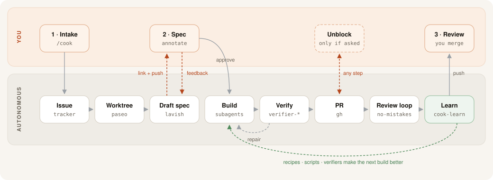

<p align="center"></p>

<p align="center"><b>From issue to reviewed PR. You write the spec. Agents do the rest.</b></p>

cook is a kit of agent skills. It takes one issue or prompt to a pull request that is ready for review. You take part in three places: the intake, the spec, and the final review. Agents do all other work in their own git worktrees. Every build leaves the project easier for the next agent. cook works with any agent that can use shell, git, and files.

## The three ideas

| Idea | What it means |
| --- | --- |
| **Spec** | Spend the most time on the spec. The spec and the mockups go through a Lavish review loop until you approve them. No code is written before you say "approve". |
| **Verify** | Verification is as important as the build. Each project has verifier skills. A build is ready only when the verifiers pass with fresh evidence. You do not test by hand. |
| **Learn** | Each build ends with a retro. Verifiers get better, and recipes and scripts keep the next agent from the same mistakes. |

## The flow



The top lane is you. The bottom lane is autonomous. You have three touchpoints: intake, spec, and review. You unblock a build only when the agent asks.

## Quick start

Lines that start with `you>` are what you type. All other lines are what cook does.

```text
# once per machine
npx skills add EthanL06/cook
~/.agents/skills/cook/doctor.sh --fix        # checks every tool, asks once, installs what it can

# once per project
cd ~/code/recipe-app
you> /cook-init
     found: Next.js web app, /api routes, Vitest, Playwright config, Postgres migrations
     drafted: .agents/cook.md, verifier-browser, verifier-api, verifier-tests, recipes/dev-setup.md
     ran each verifier once: browser ✓  api ✓  tests ✓
     review it here → http://localhost:4387/session/9f2c…   (you approve)
     wrote the files. Commit them with your next change.

# every feature
you> /cook #42                                 # GitHub issue "Save recipes offline"
     intake (defaults in [brackets]):
       done when?        [a saved recipe opens with wifi off]
       mockup variations [3]
       evidence          [screenshots + short video]
       review loop       [no-mistakes]
you> (enter to accept all)
     build started: branch feat-offline-recipes, agent a7f3
📱  "Plan ready for you - #42"  → you open the Lavish link on your phone
you> (annotate: "variation B, but put the toggle in the recipe menu") ... "approve"
     … build · verify (browser ✓ api ✓ tests ✓) · PR #57 · no-mistakes ✓ · retro: +1 recipe (service-worker cache in dev)
📱  "Ready for review - #42"  → github.com/you/recipe-app/pull/57

# impatient? ask, from any session
you> /cook-status                              # every build: step, who it waits on, how long

# more builds at the same time, from the same session
you> /cook "add CSV export to the shopping list"
you> /cook #45 on desktop-pc                   # runs on another Tailscale machine

# after you merge
you> /cook cleanup                             # removes merged worktrees, agents and branches
```

## Install

Choose one of three ways. Each way installs the skills globally. Global install links the skills into `~/.agents/skills` and `~/.claude/skills`.

### 1. Paste a prompt into your agent

```text
Install the cook kit from https://github.com/EthanL06/cook.

1. Clone the repo to ~/Developer/cook.
2. Run ~/Developer/cook/install.sh add. It links the skills and checks the tools.
3. Show me the report: what is missing, what is required, and what is optional.
4. Ask me once if I want the missing tools installed. On yes, run
   ~/Developer/cook/skills/cook/doctor.sh --fix --yes and show me the result.
5. Walk me through the steps under "Do these yourself" (sign-ins, API keys).
6. Ask me which optional parts I want: ntfy push, Tailscale machines, a CLI proxy.
7. Offer to run /cook-init in my project.

Never type or store a secret for me. This includes tokens, API keys, and passwords.
When a tool needs a secret, tell me where to put it and let me do it.
```

### 2. skills CLI

```bash
npx skills add EthanL06/cook
~/.agents/skills/cook/doctor.sh --fix
```

The skills CLI does not run setup steps. If you skip doctor, `/cook` and `/cook-init` run it for you the first time.

### 3. git clone

```bash
git clone https://github.com/EthanL06/cook ~/Developer/cook && ~/Developer/cook/install.sh add
```

### install.sh commands

| Command | What it does |
| --- | --- |
| `install.sh add [--project <dir>]` | Links the skills. With `--project`, installs into the `.agents/skills` folder of one repo. |
| `install.sh update [--project <dir>]` | Pulls the latest kit. Global links update by themselves. With `--project`, copies the new version into the repo. |
| `install.sh remove [--project <dir>]` | Removes the skills that install.sh put there. Your `cook.md`, verifiers and recipes stay. |
| `install.sh doctor [--fix]` | Checks each tool the project needs. With `--fix`, it lists the install commands, asks once, and runs only what you approve. |

## Missing tools

`doctor.sh` checks what this machine needs for the current project. It reads `.agents/cook.md`, so a Linear project needs `LINEAR_API_KEY`, `review: greptile` needs a Greptile skill, and `ui_refs: mobbin` needs a Mobbin sign-in.

- `doctor.sh` shows the report. Nothing changes.
- `doctor.sh --fix` lists the install commands (brew, npm, npx, the agent-browser Chrome download, the no-mistakes installer), asks once, runs what you approve, and checks again.
- Steps that need an account, a password or a secret are never run. Doctor lists them under "Do these yourself": `gh auth login`, the Claude Code or Codex sign-in, API keys, Mobbin and ntfy.
- `/cook` runs `doctor.sh --quick` at the start of each build. It is silent when the last check passed in the past 24 hours.

## The skills

| Skill | Use it to |
| --- | --- |
| `/cook` | Start a build from an issue, URL, or prompt. It has four modes: intake, hub, build, and cleanup. The session you start from stays a hub that reports plan links, blockers, and PRs. |
| `/cook-init` | Set up one project. It reads the repo, drafts `.agents/cook.md` and the verifiers, and runs each verifier once before it writes the verifier. |
| `/cook-verify` | Verify a finished build. It routes to the project verifier skills and ends with a PASS, FAIL, or BLOCKED receipt. |
| `/cook-learn` | Run the retro. It finds what to write down or fix so the next build is better. |
| `/cook-status` | See every build. It is read-only. Use `--watch` to redraw every 10 seconds. Use `/cook-status <ref>` for detail on one build. |

### What /cook-init creates

| Path | Content |
| --- | --- |
| `.agents/cook.md` | Project facts: a YAML header and Markdown rules. |
| `.agents/skills/verifier-*` | One verifier for each area the repo has. |
| `.agents/recipes/` | `README.md` index and `dev-setup.md`. |
| `AGENTS.md` | A "Cooking" section. |
| `scripts/qa/` | Not made at init. The retro makes it later. |

The init preflight needs two things:

- A GitHub remote. If there is none, init offers `gh repo create --private`. It runs the command only after you say yes.
- A clean, committed tree. If the tree is not clean, init stops and asks you to commit. It never commits for you.

## What you need

| Part | Default | Status | Role |
| --- | --- | --- | --- |
| Specs and mockups | [Lavish](https://github.com/kunchenguid/lavish-axi) (`npx -y lavish-axi`) | Required | Review loop for the spec |
| Agents | [Paseo](https://paseo.sh) | Required | Agents in git worktrees, parallel builds |
| CLIs | [AXI](https://axi.md) tools: lavish-axi, and linear-sdk-axi for Linear | Required | Used in place of MCP servers. Use fewer tokens. |
| Browser | [agent-browser](https://github.com/vercel-labs/agent-browser) | Required | Browser verifier |
| Git host | `gh` and `git` | Required | Push and PR |
| Tracker | github | Pluggable | `github`, `linear`, or `none` |
| Review loop | [no-mistakes](https://kunchenguid.github.io/no-mistakes/) | Pluggable | `no-mistakes`, `greptile`, or `none` |
| Browser option | agent-browser | Pluggable | `agent-browser`, `chrome-devtools-axi`, or `playwright-axi` |
| Push to phone | ntfy | Optional | Pushover also works. Config is in `~/.config/cook/notify.env`. |
| Many machines | Tailscale | Optional | Run builds on other machines. Lavish links open on your phone. |
| UI references | Mobbin (`mobbin-axi`) | Pluggable | `ui_refs: mobbin` or `none` (default). Needs a Mobbin account. |
| Many accounts | CLI proxy | Optional | Guide only. cook does not use it directly. |

## Hard rules

- cook never merges.
- cook never force-pushes.
- cook never rebases a pushed branch.
- cook never writes data or applies migrations to a shared environment. Deploy steps go in a comment for a person.
- cook stops only the processes that it started.
- cook sends one push for each blocker.

## Links

- [Workflow guide](docs/guide.md): every tool, why it is in the flow, and how to use it.
- [cook.md reference](docs/cook-md.md): every field in `.agents/cook.md`.

## Credits

cook builds on the work of Kun Chen. Watch these videos:

- [L8 Principal's Agentic Engineering Workflow](https://www.youtube.com/watch?v=iQyg-KypKAA)
- [How This Ex-Meta L8 Engineer Ships 40 PRs a Day with AI Agents](https://www.youtube.com/watch?v=88B6DimMD2g)

Tools from Kun Chen that cook uses: [Lavish](https://github.com/kunchenguid/lavish-axi), [AXI](https://github.com/kunchenguid/axi), and [no-mistakes](https://kunchenguid.github.io/no-mistakes/).

## License

MIT
